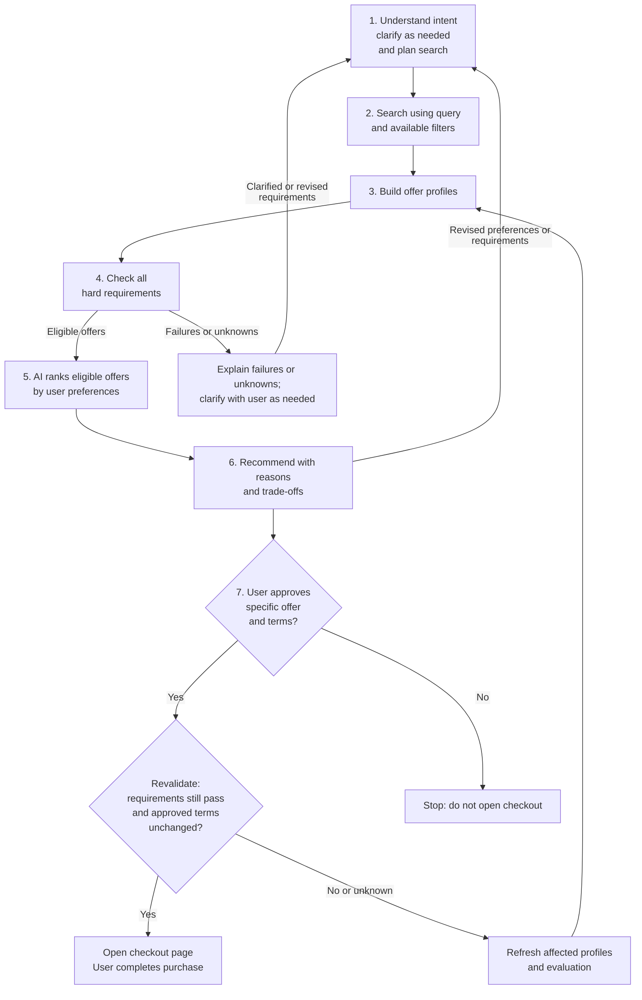

# WorthIt AI - Brainstorm

## 1. What shoppers check when comparing deals

Goal: Help buyers choose the best-fit deal and seller, not simply the lowest
listed price.

Start with four core questions:

- Can I trust the seller?
- Is the price good?
- Is the product good?
- Is it right for me?

### Shopper comparison checklist

| Check | What the shopper looks for |
| --- | --- |
| Seller trust | Mall/official-store badge, shop rating, sales history, and signs of authenticity. A Mall badge is a trust signal, not a guarantee. |
| Product details | Fits my needs: specifications, features, compatibility, dimensions/materials. Comparable offers: exact model, variant, size/storage, condition, and included items. |
| Actual price | Price for the selected variant, shipping, usable vouchers, discount conditions, and total payable, not just the advertised starting price. |
| Buyer experience | Recurring praise and complaints, recent reviews, buyer photos/videos, and whether reviews concern the same variant. |
| Purchase protection | Return/refund conditions, warranty coverage, who handles claims, and any exclusions. |
| Delivery | Arrival estimate, local versus overseas shipping, stock availability, and whether the product arrives when needed. |

### Separate product feedback from seller feedback

- Product feedback: "Battery drains quickly."
- Seller/deal feedback: "Wrong item shipped" or "Poor packaging."

These answer different questions and should not be mixed.

## 2. Proposed shopping pipeline

Status: Working proposal for iteration, not a finalized implementation or
scoring formula.

```text
Understand intent -> Plan search -> Search -> Build offer profiles
  -> Filter -> Rank -> Recommend -> Request approval -> Revalidate
  -> Open checkout / Stop
```

Search finds candidates, profiles collect evidence, filtering enforces
requirements, and ranking makes trade-offs.

### Pipeline diagram



### Tool/API mapping

Proposed operations for iteration; marketplace endpoints and providers remain
to be verified. Numbered outputs correspond to the operations in each row.

| Step | Tools/API needed | Output |
| --- | --- | --- |
| 1. Understand intent and plan search | 1. `interpret_intent` (AI): extract stated needs without inventing hard requirements; preserve ambiguities and missing information.<br/>2. `get_search_capabilities`: read supported filters, values, and sorting options.<br/>3. `build_search_plan` (AI): generate query and filters from user intent using supported parameters; application logic checks parameter validity and consistency with intent before execution. | 1. `ShoppingIntent`<br/>2. `SearchCapabilities`<br/>3. `SearchPlan` |
| 2. Search | 1. `search_products`: execute the query and supported filters; reuse the same tool with pagination parameters for additional pages when needed. | 1. `SearchResults` |
| 3. Build offer profiles | 1. `get_product_details`: fetch variants, specifications, condition, and included items.<br/>2. `get_seller_details`: fetch shop badges, rating, and sales history.<br/>3. `get_reviews`: fetch available reviews and their variant/date context.<br/>4. `summarize_reviews` (AI): extract recurring themes from retrieved reviews.<br/>5. `get_offer_quote`: look up selected-variant price, stock, shipping, and eligible discounts for the buyer context.<br/>6. `get_purchase_policies`: look up return and warranty terms.<br/>7. `assemble_offer_profile` (application logic): normalize the retrieved facts and attach evidence. | 1. `ProductDetails`<br/>2. `SellerDetails`<br/>3. `ReviewResults`<br/>4. `ReviewSummary`<br/>5. `OfferQuote`<br/>6. `PurchasePolicies`<br/>7. `OfferProfile` |
| 4. Filter | 1. `evaluate_requirements` (application logic): check each offer profile against every stated hard requirement; no additional data lookups. | 1. `FilterResults` |
| 5. Rank | 1. `rank_offers` (AI): compare and order eligible offers using the user's explicit preferences and evidence in the offer profiles; do not override Step 4 eligibility. | 1. `RankingResults` |
| 6. Recommend | 1. `explain_recommendation` (template or optional AI): explain the evaluation using available evidence. | 1. `Recommendation` |
| 7a. Request approval | - | 1. `CheckoutApproval` |
| 7b. Revalidate | 1. Reuse `get_offer_quote` and relevant product, seller, and policy lookups to refresh decision-critical facts.<br/>2. `validate_approved_offer` (application logic): recheck requirements and compare fresh terms with approved terms. | 1. Updated `OfferProfile`<br/>2. `CheckoutValidation` |
| 7c. Open checkout / stop | 1. `open_checkout`: navigate to the marketplace checkout for the approved offer after successful revalidation; checkout-link or navigation support still to verify. | 1. `CheckoutNavigation` |

### Output models

The JSON below describes fields and types, not example response values.
`Type[]` means an array; `Type | null` means the value can be unknown.
Quoted alternatives describe allowed string values. All fields are required;
use `null` for unknown values and `[]` for a known empty list. Dates use
`YYYY-MM-DD`; timestamps use ISO 8601 with a timezone.

#### Shared types

```json
{
  "Money": {
    "amount_minor": "integer",
    "currency": "string"
  },
  "FieldSource": {
    "field_path": "string",
    "source_url": "string",
    "observed_at": "string",
    "basis": "'seller_claim' | 'platform_reported' | 'buyer_review' | 'independently_verified'"
  },
  "Attribute": {
    "name": "string",
    "value": "string | number | boolean",
    "unit": "string | null"
  },
  "FilterValue": "string | number | boolean | string[] | number[]"
}
```

`amount_minor` uses the currency's smallest unit: VND 15000000 is stored as
15000000; USD 19.99 is stored as 1999. Never add or compare amounts in different
currencies without an explicit conversion.

`field_path` identifies the fact supported by a source, such as
`seller.is_mall` or `quote.shipping_cost`. Sources in an `OfferProfile` use paths
from the profile root; standalone responses use paths from their own root.

#### Step 1 outputs

```json
{
  "ShoppingIntent": {
    "product_description": "string",
    "quantity": "integer | null",
    "requirements": [{
      "requirement_id": "string",
      "user_text": "string",
      "field_path": "string | null",
      "operator": "'eq' | 'gte' | 'lte' | 'contains' | 'in' | null",
      "value": "FilterValue | null",
      "unit": "string | null"
    }],
    "preferences": [{
      "preference_id": "string",
      "user_text": "string",
      "field_path": "string | null",
      "direction": "'lower' | 'higher' | 'earlier' | 'preferred_value' | null",
      "preferred_value": "FilterValue | null",
      "priority": "integer | null"
    }],
    "questions_for_user": "string[]"
  },
  "SearchCapabilities": {
    "filters": [{
      "name": "string",
      "description": "string",
      "value_type": "'string' | 'number' | 'boolean' | 'string[]' | 'number[]'",
      "allowed_values": "FilterValue | null",
      "minimum": "number | null",
      "maximum": "number | null",
      "unit": "string | null"
    }],
    "sort_options": "string[]",
    "pagination": "'page' | 'cursor' | 'none'"
  },
  "SearchPlan": {
    "query": "string",
    "filters": [{
      "name": "string",
      "value": "FilterValue",
      "requirement_ids": "string[]"
    }],
    "sort_by": "string | null",
    "post_search_requirement_ids": "string[]"
  }
}
```

Requirement and preference paths refer to `OfferProfile` fields. Preserve
unresolved intent with null fields and a question rather than inventing a
constraint. Budget values must specify currency and whether they apply to item
price or total. Preference priority is user-stated order, starting at 1, or null
when unspecified.

#### Step 2 output

```json
{
  "SearchResults": {
    "items": [{
      "listing_id": "string",
      "seller_id": "string",
      "url": "string",
      "title": "string",
      "image_url": "string | null",
      "advertised_price_from": "Money | null"
    }],
    "next_page": "integer | null",
    "next_cursor": "string | null",
    "has_more": "boolean | null"
  }
}
```

The advertised starting price is not the price of a confirmed product variant.
Pagination fields are null when unsupported or unavailable.

#### Step 3 outputs

```json
{
  "ProductDetails": {
    "listing_id": "string",
    "title": "string",
    "brand": "string | null",
    "model": "string | null",
    "variants": [{
      "variant_id": "string",
      "name": "string",
      "attributes": "Attribute[] | null",
      "condition": "'new' | 'used' | 'refurbished' | null",
      "included_items": "string[] | null"
    }],
    "specifications": "Attribute[] | null",
    "sources": "FieldSource[]"
  },
  "SellerDetails": {
    "seller_id": "string",
    "name": "string",
    "url": "string",
    "is_mall": "boolean | null",
    "is_official_store": "boolean | null",
    "rating": "number | null",
    "rating_scale_max": "number | null",
    "rating_count": "integer | null",
    "sold_count": "integer | null",
    "sources": "FieldSource[]"
  },
  "ReviewResults": {
    "listing_id": "string",
    "total_review_count": "integer | null",
    "average_rating": "number | null",
    "rating_scale_max": "number | null",
    "retrieved_review_count": "integer",
    "reviews": [{
      "review_id": "string",
      "variant_id": "string | null",
      "rating": "number | null",
      "text": "string | null",
      "posted_at": "string | null",
      "image_urls": "string[] | null",
      "video_urls": "string[] | null",
      "source_url": "string"
    }],
    "sources": "FieldSource[]"
  },
  "ReviewSummary": {
    "listing_id": "string",
    "analyzed_review_count": "integer",
    "themes": [{
      "subject": "'product' | 'seller'",
      "sentiment": "'positive' | 'negative' | 'mixed'",
      "description": "string",
      "review_ids": "string[]",
      "matching_variant_review_count": "integer"
    }],
    "limitations": "string[]"
  },
  "OfferQuote": {
    "listing_id": "string",
    "variant_id": "string",
    "quantity": "integer",
    "delivery_area": "string | null",
    "item_unit_price": "Money | null",
    "shipping_cost": "Money | null",
    "other_fees": "Money | null",
    "discounts": [{
      "discount_id": "string",
      "description": "string",
      "amount": "Money | null",
      "conditions": "string[]",
      "eligible": "boolean | null",
      "applied": "boolean"
    }],
    "total": "Money | null",
    "in_stock": "boolean | null",
    "shipping_origin": "string | null",
    "estimated_delivery_from": "string | null",
    "estimated_delivery_to": "string | null",
    "observed_at": "string",
    "sources": "FieldSource[]"
  },
  "PurchasePolicies": {
    "listing_id": "string",
    "variant_id": "string",
    "returns_accepted": "boolean | null",
    "return_window_days": "integer | null",
    "return_conditions": "string[] | null",
    "warranty_months": "integer | null",
    "warranty_provider": "string | null",
    "warranty_conditions": "string[] | null",
    "sources": "FieldSource[]"
  },
  "OfferProfile": {
    "offer_id": "string",
    "listing_url": "string",
    "selected_variant_id": "string",
    "product": "ProductDetails",
    "seller": "SellerDetails",
    "reviews": "ReviewResults",
    "review_summary": "ReviewSummary",
    "quote": "OfferQuote",
    "policies": "PurchasePolicies",
    "missing_fields": "string[]",
    "sources": "FieldSource[]"
  }
}
```

One offer identifies one seller, listing, variant, and quantity. IDs and quantity
must agree across its profile sections. Unknown variant identity must be
resolved before creating a comparable offer.

`total` covers the requested quantity, shipping, fees, and applied discounts.
It is null unless all required amounts and discount eligibility are known.
Unknown fees are not zero; only confirmed eligible discounts may be applied.

Review summaries describe only retrieved reviews. Each theme cites those
reviews; reviews with unknown variant IDs do not count as matching the selected
variant. `missing_fields` lists unknown profile paths rather than guessed values.

#### Step 4 output

```json
{
  "FilterResults": {
    "offers": [{
      "offer_id": "string",
      "status": "'eligible' | 'excluded' | 'unresolved'",
      "checks": [{
        "requirement_id": "string",
        "result": "'pass' | 'fail' | 'unknown'",
        "reason": "string",
        "profile_field_paths": "string[]"
      }]
    }]
  }
}
```

An offer is excluded if any check fails, unresolved if none fail but at least
one is unknown, and eligible only when all requirements pass.

#### Step 5 output

```json
{
  "RankingResults": {
    "ranked_offers": [{
      "offer_id": "string",
      "rank": "integer",
      "preference_reasons": [{
        "preference_id": "string",
        "reason": "string",
        "profile_field_paths": "string[]"
      }],
      "trade_offs": "string[]",
      "missing_fields": "string[]"
    }]
  }
}
```

Ranks start at 1. Each eligible offer appears once; excluded and unresolved
offers must not appear.

#### Step 6 output

```json
{
  "Recommendation": {
    "recommended_offer_id": "string | null",
    "reasons": "string[]",
    "alternatives": [{
      "offer_id": "string",
      "why_choose_instead": "string",
      "trade_offs": "string[]"
    }],
    "limitations": "string[]",
    "questions_for_user": "string[]"
  }
}
```

Offer IDs must come from the ranking. If no recommendation can be supported,
use a null recommended offer and explain why in `limitations`.

#### Step 7 outputs

```json
{
  "CheckoutApproval": {
    "decision": "'approved' | 'declined' | 'revise'",
    "displayed_offer": "OfferProfile",
    "decided_at": "string",
    "requested_changes": "string | null"
  },
  "CheckoutValidation": {
    "offer_id": "string",
    "checked_at": "string",
    "status": "'ready' | 'changed' | 'requirements_not_met' | 'unknown'",
    "requirement_checks": "FilterResults",
    "changed_fields": "string[]",
    "unknown_fields": "string[]",
    "reasons": "string[]"
  },
  "CheckoutNavigation": {
    "offer_id": "string",
    "checkout_url": "string | null",
    "status": "'opened' | 'failed'",
    "error_message": "string | null"
  }
}
```

Approval captures the exact displayed offer and terms. Validation compares
fresh data against that snapshot; `ready` requires an approved decision, passing
requirements, and unchanged approved terms. A failed navigation must include
an error message, and opening checkout is not proof of purchase.

### Step 1. Understand intent and plan search

Turn the user's request into:

- Requirements: must satisfy, such as model, minimum storage, budget ceiling,
  or Mall-only.
- Preferences: trade-offs, such as cheaper price versus faster delivery.
- Missing information and ambiguities: preserve explicitly; leave unspecified
  requirements unset rather than guessing, and ask the user when the missing
  information materially affects the search or decision.

AI builds the search query and selects supported filters based on user intent
and the available tools. Track which requirements the tools can enforce and
which need checking afterward.

Application logic validates the generated search plan before execution:

- Parameter names must be supported by the search tool.
- Values and types must satisfy the tool's accepted options and constraints.
- Filters must preserve user intent: "prefer Mall" must not become a mandatory
  Mall-only filter.

This validates search parameters, not product eligibility.

Ask relevant questions before searching when necessary, or during later steps
when ambiguities emerge. Incorporate the answers into intent and rerun affected
stages.

### Step 2. Search

Use the query and available filters to retrieve candidate listings.

Search filters narrow the pool; they do not necessarily prove that every
returned listing satisfies the requirements.

### Step 3. Build offer profiles

An offer is a specific product variant sold by a specific seller under specific
terms. The same product from two shops should have two profiles.

Use `OfferProfile` and its component models defined above.

Keep buyer-specific judgments separate from observed facts. "Storage: 128 GB"
belongs in the profile; "enough storage for this buyer" belongs in the
evaluation.

Step 3 owns data gathering. Collect the available information needed for
evaluation here and explicitly mark unavailable facts as unknown. Step 4
evaluates these profiles rather than repeating the same lookups.

### Step 4. Filter against requirements

Check all requirements, including those already applied during search, with
particular attention to what the search tools could not enforce.

Each check yields:

- Pass: supported by evidence.
- Fail: exclude, with a reason.
- Unknown: evidence is missing or the requirement is ambiguous; do not silently
  treat it as passing.

Only offers passing every hard requirement move into ranking. If none pass,
explain the blockers rather than quietly relaxing requirements.

Do not re-query missing facts in this step: Step 3 has already gathered the
available information. If gaps prevent a confident recommendation, explain
the limitation and keep the affected checks unknown. Ask the user for
clarification or guidance when useful. Clarification can resolve ambiguous
requirements, but it does not verify missing product or seller facts. Use the
answers to rerun affected stages; requirement changes must be explicit.

### Step 5. Rank eligible offers

AI compares and orders the eligible offers using the user's explicit
preferences and evidence in their profiles. Ranking is AI reasoning, not an
application-defined scoring formula. It must not reintroduce offers that failed
or remain unresolved in Step 4.

Keep ranking distinct from filtering:

- Requirement: "Must arrive by Friday."
- Preference: "Earlier delivery is better."

Require understandable, evidence-grounded reasons and trade-offs rather than
an unexplained numerical score. AI must identify material evidence gaps, not
invent facts or scores to fill them.

### Step 6. Recommend

Show:

- Best-fit offer and why it wins.
- A few alternatives with meaningful trade-offs.
- Relevant uncertainties and price conditions.

The user can approve, decline, or change preferences and rerun the relevant
stages.

### Step 7. Approval, revalidation, and checkout handoff

Ask the user to approve proceeding to checkout for the specific seller, variant,
quantity, price, and purchase terms.

Before opening checkout, recheck price, availability, delivery, and other
material terms. If they changed materially, return for approval rather than
proceeding under changed conditions.

After approval and successful revalidation, navigate to the marketplace checkout
for the chosen offer. Verify the available checkout-link or navigation support
before implementation. The user reviews the final terms and completes the
purchase on the marketplace; the assistant does not submit an order or payment.

Declining approval stops the flow without opening checkout. The user can stop
or revise the request and compare again.