# Musk MVP implementation plan

## Stack and runtime

Status: implemented locally. Live Shopee and OpenAI are the default;
fixture data and demo AI remain selectable in settings.
Behavior follows [brainstorm.md](../../../brainstorm.md).

| Area             | Implementation                                                                                 |
| ---------------- | ---------------------------------------------------------------------------------------------- |
| Frontend         | React 19, TypeScript 5.9, CSS; Vite 7 development server and build                             |
| AI               | OpenAI through LangChain `ChatOpenAI` (`@langchain/openai`, `@langchain/core`)                 |
| Contracts        | Zod 4 schemas plus deterministic semantic validation                                           |
| Shopee transport | Development-only Vite proxy: `/shopee-api/` to `https://shopee.vn/api/`                        |
| State            | React memory: conversation, run IDs and approval snapshots; no database or application backend |
| Validation       | Vitest 5, TypeScript, ESLint and Prettier                                                      |

OpenAI defaults: endpoint `https://api.openai.com/v1`, model
`gpt-5-mini`. Configuration is loaded from
ignored local configuration and `VITE_OPENAI_*` variables, not chat input.
Use strict structured outputs and validate their contents before continuing.

Shopee session headers, including `af-ac-enc-dat`, `cookie` and `user-agent`,
are injected server-side by the proxy from ignored `.env.local` configuration.
The proxy does not refresh sessions. OpenAI `VITE_` keys are browser-visible and
embedded in builds; never commit credentials or distribute credential-bearing builds.
See [setup and run instructions](../README.md).

## Code structure

```text
sources/musk/
  src/
    App.tsx                  Chat screen and application state
    components/
      chat/                  Messages, composer, and progress
      offers/                Recommendation, comparison, and evidence cards
        ListingReviewTrail.tsx  Listing decisions and removal reasons
      requirements.tsx       Read-only intent summary
    domain/
      schemas.ts             Shared types and runtime validation
      requirements.ts        Deterministic pass/fail/unknown checks
      checkout.ts            Approval snapshot and fresh-term validation
    pipeline/
      orchestrator.ts        Stage sequencing and checkout gating
      types.ts               Shared pipeline inputs and outputs
      interpret-intent.ts    Intent parsing and clarification
      plan-search.ts         Search capabilities and plan validation
      search-products.ts     Bounded search, pagination, deduplication
      profiles.ts            Relevance, SKU preparation, and offer assembly
      filter-offers.ts       Requirement checks; excludes confirmed failures
      rank-offers.ts         AI ranking, evidence checks, and price-only ordering
      recommend-offers.ts    Recommendation and limitations
      revalidate-offer.ts    Refresh approved offer and validate terms
      open-checkout.ts       Adapter navigation and explicit error handling
    providers/
      marketplace.ts         Marketplace contracts and adapter exports
      shopee-marketplace.ts  Live Shopee data and cart handoff
      shopee-cart.ts         Exclusive cart workspace and verified cleanup
      shopee-shipping.ts     Checkout shipping and net-price reconciliation
      checkout.ts            Cart handoff contract and fixture simulation
      ai.ts                  LangChain/OpenAI structured operations
      fixtures.ts            Explicit demo/test data
  tests/                     Domain, pipeline, UI, and checkout tests
  specs/
    plan.md                  Pipeline flow, step diagrams, and output shapes
```

## Architecture boundaries

Each chat turn first passes through `pipeline/interpret-turn.ts`. AI proposes a
validated action: new product, requirement/preference revision, clarification
answer, result question, ambiguous turn, decline, or request for UI approval.
New products clear the active intent and offers while retaining the visible chat.
Intent parsing receives only the latest message and (for the same task) the active
structured intent, never the full transcript. Requirements are searched again;
preference-only revisions reuse profiles only when all other intent fields match.
Result questions use existing evidence without marketplace calls. Text approval
never opens checkout; SKU selection, explicit UI approval and revalidation remain
mandatory. Demo routing is scripted; natural-language routing uses OpenAI.

- **UI:** Render structured state, collect SKU choices and explicit approval;
  never decide eligibility or place orders.
- **Pipeline:** Coordinate stages and adapters in the browser; abort superseded
  runs and reject stale results.
- **Domain:** Own contracts, money arithmetic, requirement checks and approval
  validation; unknown facts are not passing facts.
- **Providers:** Normalize Shopee responses and AI outputs behind typed contracts.
  Share product data during comparison; refresh it during revalidation.
- **State:** Reloading starts a new session. Request revisions invalidate prior
  results and approvals; approval binds the displayed SKU, quantity and terms.
- **Modes:** Fixture/demo execution is separate from live execution. API errors
  remain explicit; never silently substitute fixture data.

## Overall flow

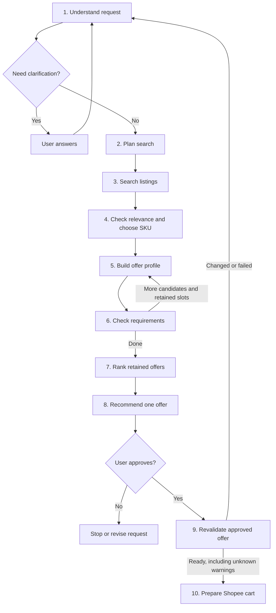

### Contract notation

The output contracts below define their nested types here, not only in source.
Implement both the shapes and the validation rules beside them. Source references:
[domain schemas](../src/domain/schemas.ts) and [pipeline types](../src/pipeline/types.ts).

- Every property is required unless marked `?`. Nullable properties must contain
  explicit `null` when unknown; `null` is not zero, false or an empty string.
- `T[]` is an array of `T`; `Record<string, T>` maps string keys to `T`.
  IDs are strings and references must match the corresponding input entities.
- These aliases carry runtime constraints, not just TypeScript primitive types:

```text
PositiveInt = number       // safe integer >= 1
NonNegativeInt = number    // safe integer >= 0
Url = string               // valid absolute URL
ISODate = string           // valid calendar date, YYYY-MM-DD
ISODateTime = string       // ISO 8601 timestamp with Z or a numeric timezone offset
Currency = string          // exactly three uppercase letters, e.g. VND
```

## 1. Understand request

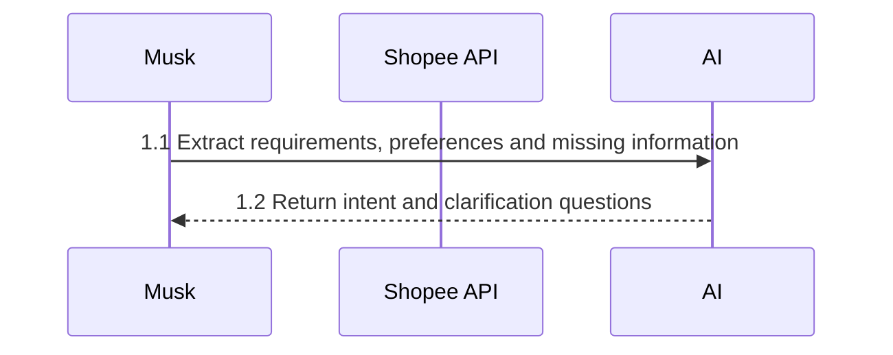

**Output:**

```text
ShoppingIntent = {
  product_description: string, quantity: PositiveInt|null, delivery_area: string|null,
  requirements: Requirement[], preferences: Preference[], questions_for_user: string[]
}
Requirement = {
  requirement_id: string, user_text: string, field_path: FieldPath|null,
  operator: "eq"|"gte"|"lte"|"contains"|"in"|null, value: Value|null, unit: string|null
}
Preference = {
  preference_id: string, user_text: string, field_path: FieldPath|null,
  direction: "lower"|"higher"|"earlier"|"preferred_value"|null,
  preferred_value: Value|null, priority: PositiveInt|null
}
Value = string | number | boolean | string[] | number[]
FieldPath =
  "product.model" | "product.storage_gb" | "product.condition"
  | "seller.is_mall" | "seller.rating"
  | "quote.total" | "quote.in_stock" | "quote.estimated_delivery_to"
  | "policies.warranty_months" | "policies.returns_accepted"
```

**Validate:** non-empty product description; requirement/preference IDs must be
unambiguous within the intent. Ask about missing quantity before quoting.
Unsupported requirements keep nullable fields instead of inventing a mapping.
Storage uses `GB`, warranty uses `months`, and total budgets use a currency code.
Delivery dates use `ISODate`, never a location. Preferences are not hard filters;
`preferred_value` specifies the desired value when that direction is used.

## 2. Plan search

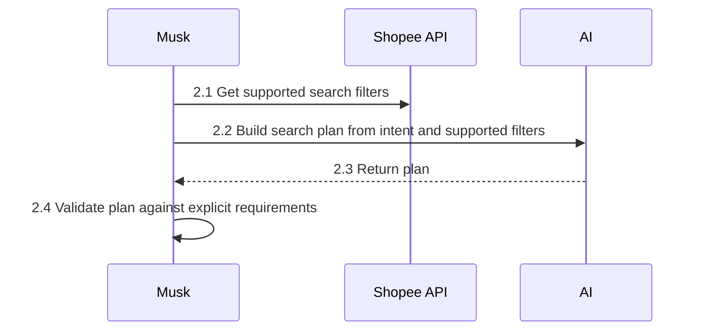

**Output:**

```text
SearchPlan = {
  query: string, filters: { name: string, value: Value, requirement_ids: string[] }[],
  sort_by: string|null, post_search_requirement_ids: string[]
}
SearchCapabilities = {
  filters: { name: string, field_path: FieldPath, values: (string|number|boolean)[] }[],
  sort_options: string[]
}
```

**Validate:** query is non-empty. Filter names/values and non-null sort options must
be advertised capabilities. Each filter maps to an equivalent explicit `eq`
requirement, never a preference. Every requirement must be covered by a filter or
`post_search_requirement_ids`; reject unknown IDs and duplicate filter names.

## 3. Search listings

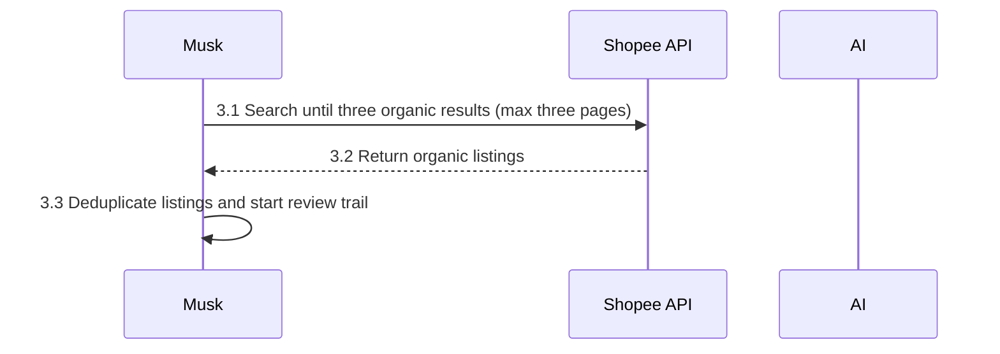

**Output:**

```text
CandidateResults = { listings: Listing[], truncated: boolean, search_review: SearchReview }
Listing = { listing_id: string, seller_id: string, url: string, title: string }
SearchReview = {
  plan: SearchPlan, pages_fetched: NonNegativeInt,
  listing_limit: PositiveInt, page_limit: PositiveInt, truncated: boolean, entries: ListingReview[]
}
ListingReview = {
  listing: Listing,
  status: "pending"|"irrelevant"|"skipped"|"excluded"|"eligible"|"unresolved"|"not_evaluated",
  reasons: string[], seller_name?: string, selected_variant?: { variant_id: string, name: string }
}
```

**Validate:** unique `(seller_id, listing_id)` pairs. Only the first three organic
results are analyzed (`listing_limit`); extra pages, up to three, are read only to make
up for ads or duplicates; `pages_fetched <= page_limit`.
`truncated` signals incomplete coverage. Inventory only fetched listings;
initial entries are `pending` and later decisions update their status and reasons.

## 4. Check relevance and choose SKU

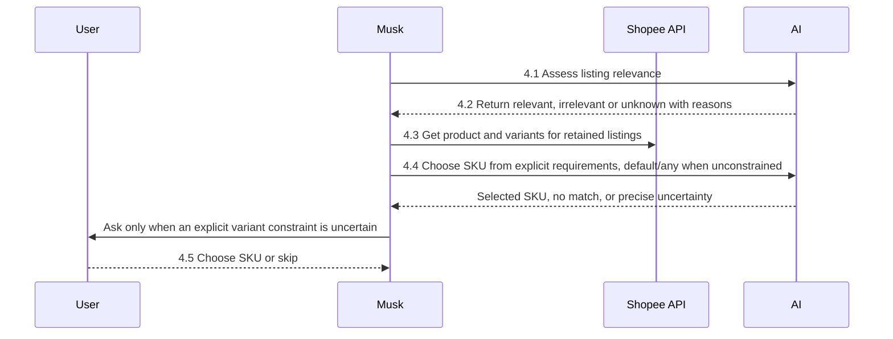

**Output:** uncertain relevance stays visible; `null` in choices means skip.
Known-unavailable variants (`has_stock=false`, `is_clickable=false`,
`is_grayout=true`, or reported `stock` below requested quantity) are not offered
to AI, fallback selection, or manual selection. Listings with no selectable
variant are skipped with a recorded reason. Missing availability stays unknown.
Quotes check `data.stock` and `data.selected_variation.max_quantity`; availability
can change before selection, so upstream failures remain explicit.

```text
PreparedSearch = {
  intent: ShoppingIntent,
  candidates: { listing: Listing, product: ProductDetails, relevance: "relevant"|"unknown" }[],
  truncated: boolean, search_review: SearchReview
}
VariantChoices = Record<string, string|null>  // key: seller_id:listing_id
ListingRelevance = {
  assessments: {
    listing_id: string, seller_id: string,
    status: "relevant"|"irrelevant"|"unknown", reason: string
  }[]
}
```

**Validate:** exactly one relevance assessment per supplied listing, with a
non-empty reason. Every prepared candidate needs a valid variant ID or an explicit
skip; reject extra keys. AI chooses from listed IDs using explicit variant requirements, including variant names for unsupported attributes. Prefer the platform default among matches; without variant constraints choose any listed SKU. Skip clear non-matches. Ask only for unresolved explicit constraints, retaining confident suggestions and reasons in the review trail. Stock, pricing and requirements are still checked after selection. Product and variant shapes are defined in step 5.

## 5. Build offer profile

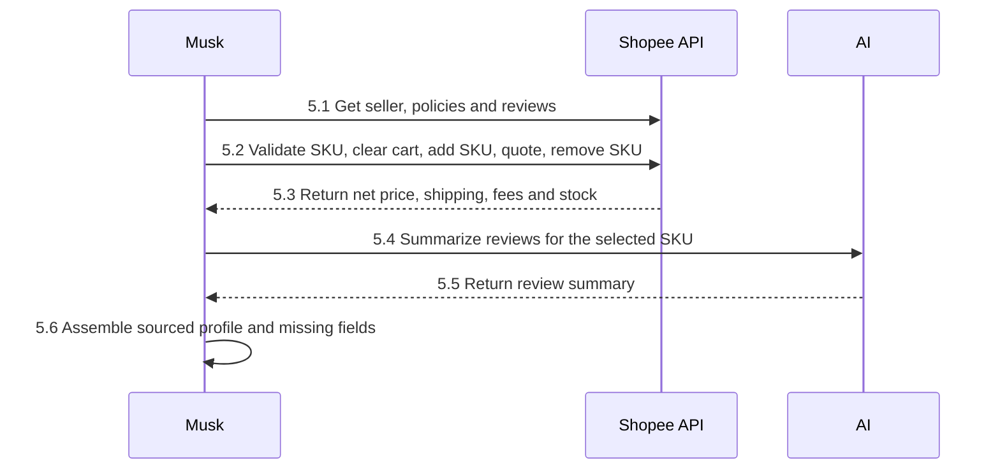

**Output:** `OfferProfile[]`, one profile per evaluated SKU.

```text
OfferProfile = {
  offer_id: string, listing_url: Url, selected_variant_id: string,
  product: ProductDetails, seller: SellerDetails,
  reviews: Review[], review_summary: ReviewSummary, quote: OfferQuote,
  policies: PurchasePolicies, missing_fields: string[], sources: FieldSource[]
}
ProductDetails = {
  listing_id: string, title: string, image_url?: Url|null, model: string|null, storage_gb: number|null,
  condition: "new"|"used"|"refurbished"|null, variants: ProductVariant[],
  default_variant_id: string|null, sources: FieldSource[]
}
ProductVariant = {
  variant_id: string, name: string, model?: string|null, storage_gb?: number|null,
  has_stock?: boolean|null, is_clickable?: boolean|null, is_grayout?: boolean|null,
  stock?: NonNegativeInt|null, image_url?: Url|null
}
SellerDetails = {
  seller_id: string, name: string, is_mall: boolean|null, rating: number|null,
  sold_count: NonNegativeInt|null, sources: FieldSource[]
}
Review = {
  review_id: string, variant_id: string|null, rating: number|null,
  text: string, posted_at: string, source_url: Url
}
ReviewSummary = {
  analyzed_review_count: NonNegativeInt,
  themes: {
    subject: "product"|"seller", sentiment: "positive"|"negative"|"mixed",
    description: string, review_ids: string[], matching_variant_review_count: NonNegativeInt
  }[],
  limitations: string[]
}
OfferQuote = {
  listing_id: string, variant_id: string, quantity: PositiveInt, delivery_area: string|null,
  item_unit_price: Money|null, shipping_cost: Money|null, other_fees: Money|null,
  discounts: Discount[], total: Money|null, in_stock: boolean|null,
  estimated_delivery_to: ISODate|null, observed_at: ISODateTime, sources: FieldSource[],
  shipping_estimated?: boolean, total_estimated?: boolean, limitations?: string[]
}
Money = { amount_minor: NonNegativeInt, currency: Currency }
Discount = {
  discount_id: string, description: string, amount: Money|null, eligible: boolean|null, applied: boolean
}
PurchasePolicies = {
  listing_id: string, variant_id: string, returns_accepted: boolean|null,
  return_window_days: NonNegativeInt|null, warranty_months: NonNegativeInt|null,
  warranty_provider: string|null, conditions: string[]|null, sources: FieldSource[]
}
FieldSource = {
  field_path: string, source_url: Url, observed_at: ISODateTime,
  basis: "seller_claim"|"platform_reported"|"buyer_review"|"independently_verified"
}
```

**Validate:**

- At least one product variant; selected/default IDs must identify listed variants.
  Listing, seller, quote and policy IDs must agree with the requested SKU;
  quantity and delivery area must agree with the intent.
- Seller/review ratings are between 0 and 5 when known. Storage is in GB;
  return windows are in days and warranties in months.
- `analyzed_review_count` equals the input review count. Each theme cites at least
  one existing review, with no duplicate IDs; matching-variant counts are derived.
- `sources` records provenance; `missing_fields` lists unknown profile paths.
  A value without supporting provenance cannot pass a requirement.

Total = checkout unit price x quantity + shipping + other fees - selected voucher.
After reconciling checkout with voucher auto-application disabled, fetch shop and platform voucher recommendations for the exact cart SKU. Select the largest eligible cash discount once; do not stack vouchers or count coins/shipping rewards as item discounts. Check validity, shop scope, minimum spend/quantity, usage and payment restrictions. Display the voucher code for manual selection at checkout.
Amounts use currency minor units: one VND unit is one dong; one USD unit is one cent.
All components must share a currency; unsafe arithmetic or unknown required pricing
leaves `total` null, never zero. The generic fixture contract may carry discounts:
subtract confirmed applied amounts once; an applied discount with unknown
eligibility or amount also leaves the total null.

## 6. Check requirements

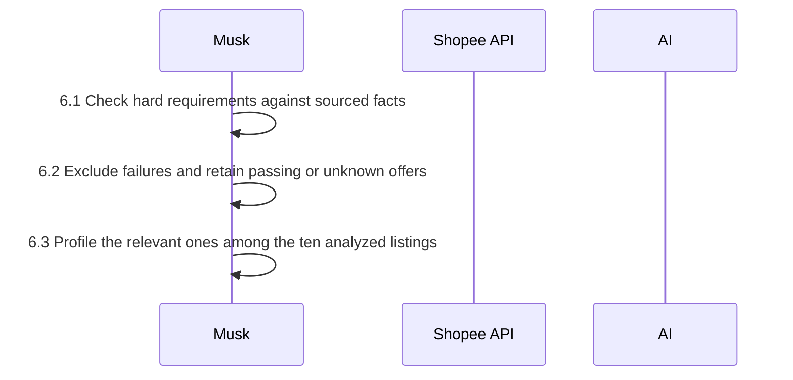

**Output:**

```text
FilterOutput = { filters: FilterResult[], candidates: OfferProfile[] }
FilterResult = {
  offer_id: string, status: "eligible"|"excluded"|"unresolved", checks: RequirementCheck[]
}
RequirementCheck = {
  requirement_id: string, result: "pass"|"fail"|"unknown",
  reason: string, profile_field_paths: string[]
}
```

**Validate:** any failed check means `excluded`; otherwise any unknown means
`unresolved`; otherwise `eligible`. Candidates contain only the latter two.
Check explicit requirements plus quantity and availability; system check IDs may
be `quantity` or `availability`. Unsupported comparisons or missing provenance
return `unknown`, not pass. `eq` uses typed equality, `contains` is case-insensitive,
`in` expects a list, and `gte`/`lte` compare numbers or valid ISO delivery dates.

## 7. Rank retained offers

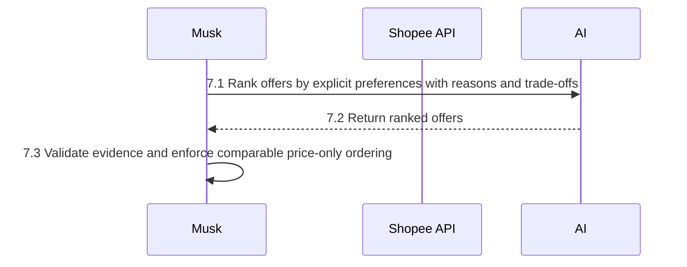

**Output:**

```text
RankingResults = { ranked_offers: RankedOffer[] }
RankedOffer = {
  offer_id: string, rank: PositiveInt,
  preference_reasons: { preference_id: string, reason: string, profile_field_paths: FieldPath[] }[],
  trade_offs: string[], missing_fields: string[]
}
```

**Validate:** every candidate appears exactly once; ranks are consecutive from 1.
Reasons reference an explicit preference and known, sourced fields. Preserve exact
missing-field lists; unknown facts cannot be ranking advantages.

## 8. Recommend one offer

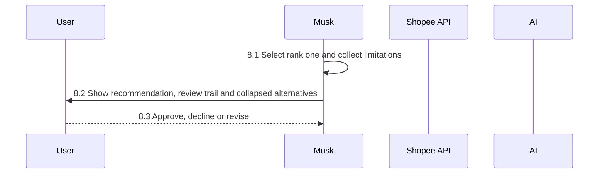

**Output:** no winner when every offer is excluded.

```text
Recommendation = { recommended_offer_id: string|null, reasons: string[], limitations: string[] }
PipelineResult = {
  intent: ShoppingIntent, profiles: OfferProfile[], filters: FilterResult[],
  ranking: RankingResults, recommendation: Recommendation, mode: string, search_review: SearchReview
}
RunResult =
  { status: "clarification", intent: ShoppingIntent }
  | ({ status: "selection" } & PreparedSearch)
  | { status: "complete", result: PipelineResult }
```

**Validate:** recommended ID is rank one's offer ID, or null for an empty ranking.
`mode` is `<fixture|shopee>/<demo|openai>`. Pauses return `clarification` or
`selection`, not a success-shaped empty recommendation.

## 9. Revalidate approved offer

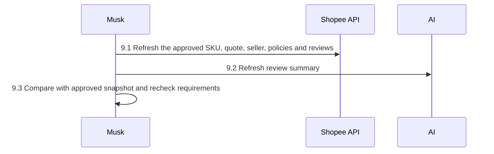

**Output:** only `ready` or `ready_with_unknowns` proceeds; changes require a fresh
comparison and approval.

```text
CheckoutApproval = {
  run_id: number, decision: "approved"|"declined", displayed_offer: OfferProfile, decided_at: ISODateTime
}
RevalidationResult = { fresh: OfferProfile, validation: CheckoutValidation }
CheckoutValidation = {
  status: "ready"|"ready_with_unknowns"|"changed"|"requirements_not_met"|"invalid_approval",
  changed_fields: string[], unknown_fields: string[], became_unknown_fields: string[],
  requirement_checks: FilterResult
}
```

**Validate:** approval must be approved and match the active run. Compare the
displayed snapshot's SKU, quantity and terms with refreshed data, ignoring
observation timestamps and source metadata. Status precedence is invalid approval,
failed requirements, changed known terms, unknown warnings, then ready.
Known values becoming unknown are warnings, not confirmed term changes.

## 10. Prepare Shopee cart

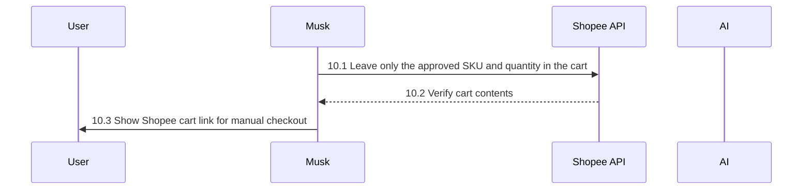

**Output:** [checkout contract](../src/providers/checkout.ts); no automated order or payment.

```text
CheckoutNavigation = { status: "ready"|"opened"|"simulated", checkout_url: string|null, message: string }
CheckoutOutcome = CheckoutNavigation
  | { status: "not_implemented", operation: string, message: string }
HandoffResult = RevalidationResult & { navigation: CheckoutOutcome|null }
```

**Validate:** blocked revalidation returns `navigation: null`. Live handoff returns
`ready` with `https://shopee.vn/cart` only after verifying the sole approved SKU
and quantity. Fixture handoff returns `simulated` with a null URL.
`opened` is permitted by the interface, not claimed by the current cart-link flow;
`not_implemented` identifies the unsupported operation instead of claiming success.

## Shared rules

- Analyze only the first three organic search results for faster testing (deduplicated by shop and
  listing); read further pages, at most three, only to make up for ads. Every later
  step (relevance, quotes, reviews, ranking) runs on those three; failures do not
  trigger fetching more.
- Review trail records kept, removed, skipped and unevaluated listings with reasons.
- Validate AI listing identities and review citations. Musk derives ranks,
  review counts and missing-field lists from the source data.
- Rank only by explicit preferences. Enforce price-only ordering when every
  total is sourced, known and in the same currency; preserve ties.
- Unknown prices, fees and policies stay unknown; missing shipping is not free.
- Cart contents are permanently cleared, never restored. Quote one SKU at a time;
  verify an empty cart afterward, including on failure or cancellation.
- Validate a fully loaded cart before mutations. Cleanup failure stops processing.
  Preserve nullable promotion metadata in cart requests. Never edit the cart concurrently.
- Known term changes or failed requirements block handoff and require a new
  comparison and approval. Unknown checks remain visible warnings.
- Shipping uses the account's saved address, not the location entered in chat.
  Manual checkout must use the same Shopee account as the configured session.
- A prepared cart is not an opened or completed checkout. Musk never places
  orders or makes payments.

## Build order

1. Define contracts and deterministic domain logic, with tests.
2. Implement provider adapters and pipeline orchestration.
3. Build the chat UI, structured offers and listing review trail.
4. Wire approval/revalidation and end-to-end tests.

Validate with `npm test`, `npm run typecheck`, `npm run lint`,
`npm run format:check` and `npm run build`.
